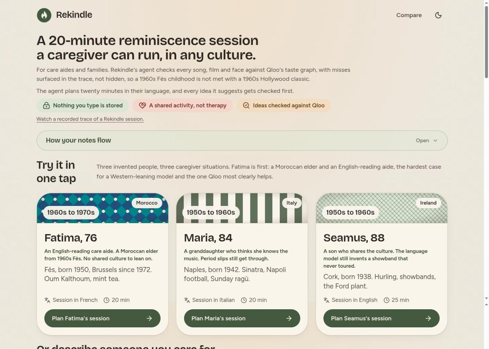

<div align="center">

# Rekindle

**Rekindle plans a culturally grounded reminiscence session for one specific elder in under a minute, every cultural anchor verified against the Qloo taste graph.**

[](https://github.com/scr4shdev/rekindle/actions/workflows/ci.yml)
[](LICENSE)
[](https://nodejs.org/)
[](https://nextjs.org/)
[](https://qloo.com)

[**Live demo**](https://rekindle-gamma.vercel.app) &nbsp;·&nbsp; [**90-second judge tour**](https://rekindle-gamma.vercel.app/tour) &nbsp;·&nbsp; **Devpost** _(coming soon)_



</div>

## What this is

A caregiver fills in a short "This is Me" sheet; a few sentences are enough. An agent turns it into a twenty-minute, six-to-eight-step session in the person's own language, with a meaning line and a tip in the caregiver's language. Every cultural reference is checked against Qloo's taste graph before it reaches the plan, and Qloo's cross-domain affinities add neighbours the notes alone would not name. Rekindle is non-medical: it plans an activity, nothing more. The printable session card and the `/tour` replay need no API keys and no network, so the demo survives any outage.

## Try it

- [**Live demo**](https://rekindle-gamma.vercel.app). Tap a persona card to replay a recorded live run in under fifteen seconds, or tap again to run the agent live. The form takes your own notes.
- [**`/tour`**](https://rekindle-gamma.vercel.app/tour). A judge-friendly ninety-second cycle through three recorded sessions (Maria from Naples, Fatima from Fès and Brussels, Seamus from Cork). No typing. Each run replays a committed trace, so it needs neither Qloo nor a language model.
- **Local**: `npm ci && npm run dev` and open `http://localhost:3000`. Mock mode works with no keys.

## Architecture at a glance

```
caregiver notes
      |
  PARSE (LLM)      anchors: formative window, loves, sensitivities, callback lines
      |
  PROPOSE (LLM)    era-and-place candidates per domain, with Qloo type hints
      |
  VERIFY (Qloo)    GET /search per candidate: hit = verified entity with id, year, image
      |            miss = set aside with a reason, visible in the trace
  EXPAND (Qloo)    GET /v2/insights from verified seeds, era-filtered per entity type,
      |            with feature.explainability so each pick names its seeds
  CRITIQUE (LLM)   one batched pass: wrong era, wrong place, cultural mismatch, emotional risk
      |
  COMPOSE (LLM)    timed session; then a deterministic, locale-aware minimum top-up
      |
  NDJSON stream to the UI, "What we heard" callbacks above step one
```

- **Ports and adapters**: the agent in `src/lib/agent/` depends only on `TastePort`, `LlmPort` and `CachePort` in `src/lib/ports/`. ESLint enforces the boundary. `src/lib/composition.ts` wires the adapters.
- **No regex or keyword lists for semantics**: cultural judgment goes through LLM structured output (see [`docs/no-regex-semantics.md`](docs/no-regex-semantics.md)). Deterministic code only reshapes already-structured data.
- **Determinism**: temperature 0, pinned model ids, versioned prompt modules in `src/lib/prompts/`, sha256 input-keyed cache. The three persona traces in `tests/fixtures/` replay byte-identical.
- **Aggregate framing**: Qloo results are always framed as aggregate ("people who enjoy X also tend to enjoy Y"), with provenance chips on each plan step and on the print card.
- **Local-first state**: after a session, three one-tap reactions per step (Sparked, Did not land, Walked away) are saved on the device; the next plan for the same name starts with a "Last time with ..." line.
- **Localised**: UI in English, French and Italian, with gender-neutral French and Italian strings.

Deeper dive: [`docs/ARCHITECTURE.md`](docs/ARCHITECTURE.md).

## Documentation

| Document | What it covers |
|---|---|
| [`docs/ARCHITECTURE.md`](docs/ARCHITECTURE.md) | Full technical tour: the six-phase agent loop, ports and adapters, determinism contract, failure modes. |
| [`docs/api.md`](docs/api.md) | HTTP contract: route handlers, NDJSON event schema, replay fixtures. |
| [`docs/qloo-api.md`](docs/qloo-api.md) | Qloo field notes: `/search`, `/v2/insights`, `/v2/tags`, era filters, parity with the `qloo` CLI. |
| [`docs/judges.md`](docs/judges.md) | 90-second judge tour, health probes, what to look for in the trace. |
| [`docs/llm-config.md`](docs/llm-config.md) | LLM provider selection, pinned model ids, mock mode. |
| [`docs/no-regex-semantics.md`](docs/no-regex-semantics.md) | Why every semantic judgment goes through schema-validated structured output. |
| [`AGENTS.md`](AGENTS.md) | Rules for every agent (human or AI) working on this repo: ownership, hard rules, architecture rules. |

## Running locally

Node 24 or later (`engines.node >= 24`, managed here via nvm).

```bash
export PATH="$HOME/.nvm/versions/node/v24.22.0/bin:$PATH"
npm ci
npm run dev      # http://localhost:3000
npm run build
npm run start
```

Mock mode works with no keys at all. To go live, copy `.env.example` to `.env.local` and set what you have; each provider switches independently:

| Variable | Purpose |
|---|---|
| `QLOO_API_KEY` | Qloo Insights API, server-side only. Host defaults to `https://hackathon.api.qloo.com`. |
| `GEMINI_API_KEY` | Google Gemini via the Vercel AI SDK. Default model is pinned in `src/lib/config.ts`. |
| `LLM_PROVIDER` | `gemini` (default when a key is present) or `ollama` for a local `qwen3:8b`. |
| `UPSTASH_REDIS_REST_URL`, `UPSTASH_REDIS_REST_TOKEN` | Optional shared cache; otherwise in-memory. |
| `REKINDLE_FORCE_MOCK` | Force mocks even when keys are set. |

The Qloo key is read only by `src/lib/config.ts` and never reaches the client.

## Testing

```bash
npm run check    # typecheck + lint + 271 unit and contract tests (vitest) + production build
npm run e2e      # Playwright, always in mock mode
```

CI runs the same `npm run check`, plus a gitleaks pass over the full history.

## Privacy posture

Mirrors the "How your notes flow" panel on the landing page.

- **What Qloo sees**: only cultural anchors, meaning public entity names, Qloo tag ids, a city-level place name and an aggregate age bucket. Never free notes, never a person's name. `withPersonalDataGuard` wraps every Qloo call and refuses any payload containing a personal term.
- **What the language model sees**: the free notes, read once by the planner on the server. They are not stored and not written to logs; cache keys are sha256 hashes and parse output is marked `sensitive` so it stays in process memory.
- **What stays on the device**: session reactions and a short note, keyed by a hashed display name, plus the printable card. No login, no database.

## Non-medical disclaimer

Rekindle plans a shared activity. It is not therapy, it does not treat or diagnose anything, and it does not replace a caregiver who knows the person. The caregiver decides what to use and when to stop. Every plan and every printed card carries this note.

## License

This project is licensed under the MIT License. See [LICENSE](LICENSE) for details.

## Credits

- [Qloo](https://qloo.com) taste graph for verification and cross-domain affinities
- Google Gemini as the language model, called through the Vercel AI SDK v7
- Next.js 16, React 19, Tailwind v4, shadcn on Base UI
- zod 4, pino, vitest, Playwright
